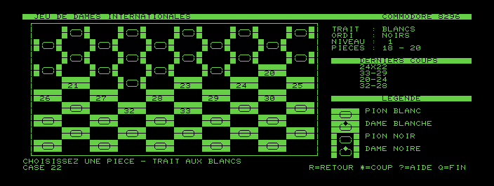
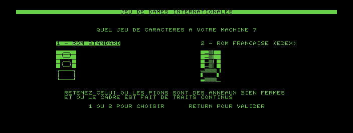

# Jeu de dames internationales pour Commodore 8296

Un jeu de **dames internationales (10×10)** entièrement écrit en **assembleur 6502**
pour le **Commodore 8296**, avec un adversaire capable de jouer correctement.
Aucune modification matérielle : le programme tourne sur la machine telle qu'elle est.



## Ce que fait le programme

- **Règles officielles FFJD** : prise obligatoire en avant comme en arrière, rafles,
  **prise majoritaire**, **dames volantes**, promotion seulement si le pion *termine*
  son coup sur la dernière rangée. Les pièces prises sont retirées en fin de rafle et
  ne peuvent pas être sautées deux fois.
- **Adversaire** : recherche alpha-bêta avec approfondissement itératif limité par le
  temps, tri des coups et table de transpositions (hachage Zobrist). Trois niveaux de
  réflexion.
- **Affichage 80 colonnes** en caractères PETSCII : une case de 5×2 caractères paraît
  carrée sur le moniteur du 8296, dont les caractères sont bien plus hauts que larges.
- **Retour arrière** sur les coups joués, historique des derniers coups, compteur de
  pièces, bruitages et animation des prises.
- Partie contre la machine (dans l'un ou l'autre camp) **ou à deux joueurs**.

## Compatibilité ROM

Le générateur de caractères n'a pas les mêmes codes d'une machine à l'autre : certaines
8296 françaises portent une EPROM modifiée (**EDEX**) dont les formes graphiques et les
caractères accentués sont ailleurs que sur une ROM standard.

Le jeu s'ouvre donc sur un **écran de choix** qui montre les deux jeux de caractères
côte à côte — un pion blanc, un pion noir et un cadre — et vous laisse retenir celui
qui s'affiche correctement :



La machine est reconnue automatiquement (par l'empreinte de sa ROM d'éditeur) et le
préréglage présélectionné en conséquence ; `1` et `2` corrigent, `RETURN` valide. Le
réglage reste modifiable depuis le menu, et `C` y rouvre cet écran.

> **Remarque** : les codes de la ROM française ont été relevés sur une machine réelle.
> Faute de disposer du générateur de caractères correspondant, ce préréglage n'a pas pu
> être vérifié dans l'émulateur — seul le mode ROM standard l'est.

## Commandes

### Écran de réglages

| Touche | Effet |
|---|---|
| `8` `2` ou ↑ ↓ | choisir la ligne |
| `4` `6` ou ← → | modifier le réglage |
| `C` | revoir les deux jeux de caractères |
| `ESPACE` | commencer la partie |
| `Q` | quitter |

Trois réglages : le **niveau** (1 à 3), le **camp du joueur** et le **jeu de caractères**.
Aux dames les Blancs jouent toujours le premier coup : choisir son camp revient donc à
décider qui commence.

### En partie

Le curseur ne circule que sur les cases foncées.

| Touche | Effet |
|---|---|
| ↑ ↓ ← → | déplacer le curseur |
| `8` `2` `4` `6` | idem, au pavé numérique |
| `7` `9` `1` `3` | déplacements en diagonale |
| `ESPACE` ou `RETURN` | choisir une pièce, puis jouer le coup |
| `*` | saisir un numéro de case (notation 1–50) |
| `R` | revenir en arrière |
| `M` | revenir aux réglages |
| `N` | nouvelle partie |
| `O` | changer le camp tenu par la machine |
| `A` | animation et bruitages, avec ou sans |
| `?` | rappel des commandes |
| `Q` | quitter |

Sur une rafle ambiguë — deux chemins menant à la même case en mangeant des pièces
différentes — le jeu demande de désigner une pièce à prendre pour départager.

## Installation sur la machine

Les binaires sont attachés à la [dernière release](../../releases/latest).

- **Disquette** : `dames.d64`, à écrire sur une disquette 1541/4040, puis
  `LOAD"DAMES",8` et `RUN`.
- **Cassette** (par exemple avec un **Tapuino**) : `dames.tap`, puis `LOAD` et `RUN`.
- **Fichier seul** : `dames.prg`, qui se charge à l'adresse `$0401` et démarre par `RUN`.

## Compilation

Il faut [64tass](https://sourceforge.net/projects/tass64/) :

```sh
sudo apt install 64tass
64tass --cbm-prg -o dames.prg main.asm
```

Ajouter `-L dames.lst` pour obtenir un listing.

Les tables de constantes (correspondance cases ↔ plateau ↔ écran, valeurs de position,
hachage Zobrist) sont engendrées par un script :

```sh
python3 outils/generer_tables.py
```

## Essai dans l'émulateur

```sh
sudo apt install vice
xpet -model 8296 -autostart dames.prg
```

**Les ROMs ne sont pas fournies ici** : elles appartiennent à Commodore et ne font pas
partie de ce projet. Debian ne les distribue pas non plus. Il faut les prendre dans une
archive officielle de VICE (par exemple `SDL2VICE-3.9-win64.zip` sur
[zimmers.net](https://www.zimmers.net/anonftp/pub/cbm/crossplatform/emulators/VICE/)) et
les déposer dans le dossier utilisateur, sans droits particuliers :

```sh
unzip -j -o vice.zip "SDL2VICE-3.9-win64/PET/*.bin"  -d ~/.local/share/vice/PET/
unzip -j -o vice.zip "SDL2VICE-3.9-win64/DRIVES/*"   -d ~/.local/share/vice/DRIVES/
```

Les ROMs **DRIVES sont indispensables** : sans elles, `-autostart` échoue en silence et
laisse un écran noir, ce qui ressemble à s'y méprendre à un plantage du programme.

## Organisation des sources

| Fichier | Rôle |
|---|---|
| `main.asm` | amorce BASIC, initialisation, boucle principale |
| `constantes.asm` | adresses matérielles, codes écran, géométrie |
| `ecran.asm` | damier, pièces, panneau d'informations |
| `ecran_rom.asm` | choix du jeu de caractères |
| `menu.asm` | écran de réglages |
| `clavier.asm` | curseur, saisie, commandes |
| `coups.asm` | moteur de règles : génération et application des coups |
| `regles.asm` | lien entre le moteur et l'interface |
| `ia.asm` | évaluation et recherche alpha-bêta |
| `son.asm` | bruitages et animation des prises |
| `donnees.asm` | textes, tables, variables |
| `donnees_tables.asm` | tables engendrées par `outils/generer_tables.py` |

`coups.asm` et `ia.asm` ne dépendent pas de l'affichage : c'est ce qui permet de les
éprouver sur banc.

## Tests

Le moteur de règles est confronté à un **prototype de référence écrit en Python**
(`outils/reference.py`), qui sert d'oracle. Les positions sont embarquées dans un
programme de test, exécutées dans VICE, et les coups produits par le 6502 sont relus
**dans la mémoire de l'émulateur** par son moniteur distant, puis comparés un à un.

```sh
python3 outils/test_reference.py          # l'oracle, sur des positions calculées à la main
python3 outils/test_coups.py -n 300       # le générateur de coups 6502 contre l'oracle
python3 outils/test_ia.py -p 3 -n 12      # l'évaluation et la recherche
python3 outils/test_affichage.py          # l'affichage et les commandes
python3 outils/carte_memoire.py           # occupation de la RAM
```

`outils/lire_ecran.py` relit une capture d'écran de VICE et reconstitue la grille 80×25
de codes écran, en comparant chaque cellule aux glyphes du générateur de caractères :
c'est ce qui permet de vérifier l'affichage sans avoir à regarder l'image.

## Licence

[MIT](LICENSE) — Fafa.

Développé avec l'aide de [Claude Code](https://claude.com/claude-code).
